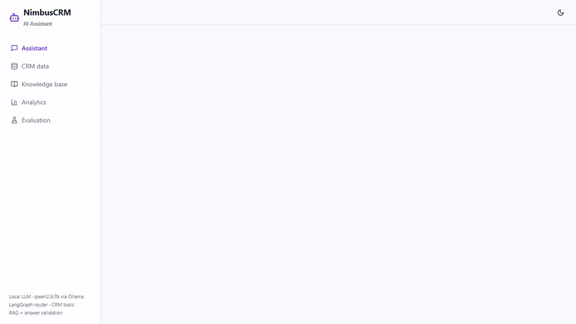
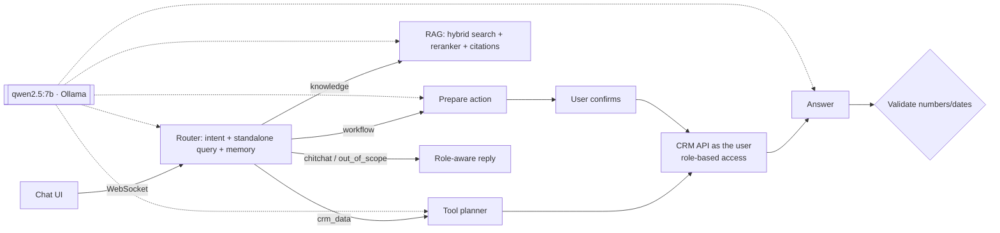
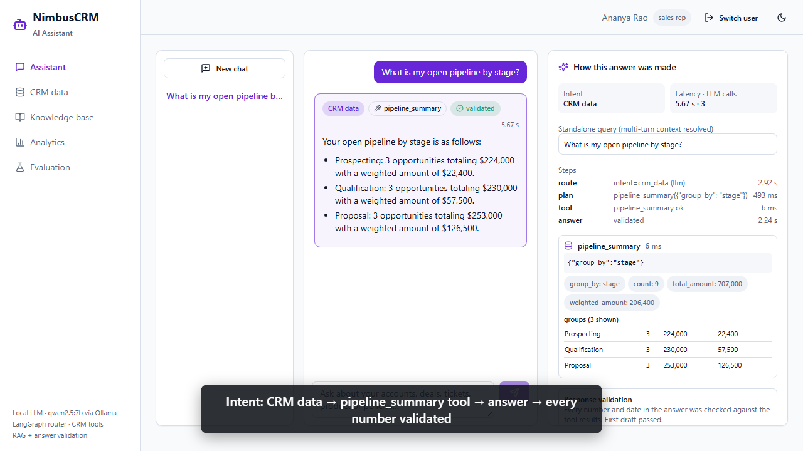
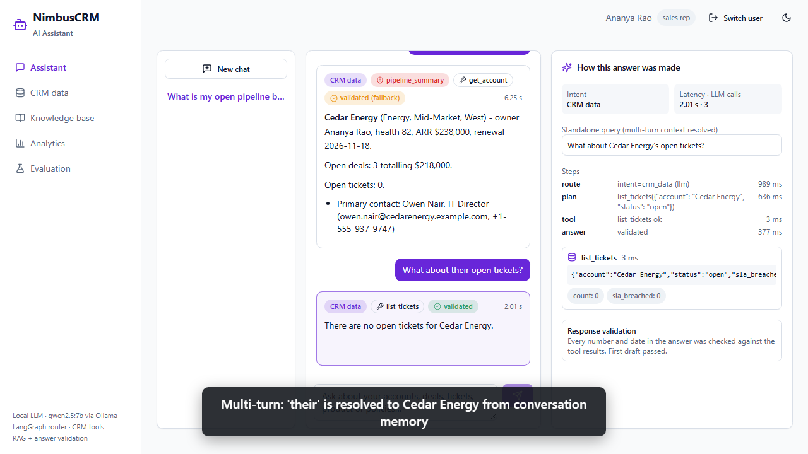
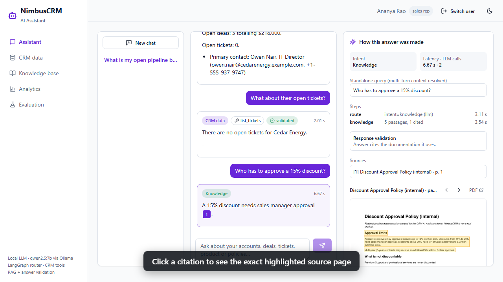
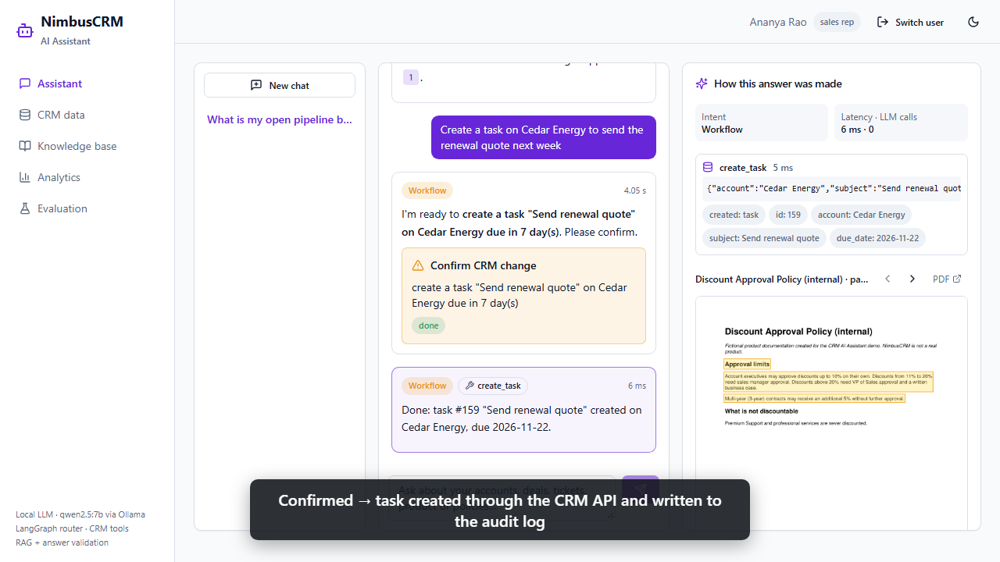
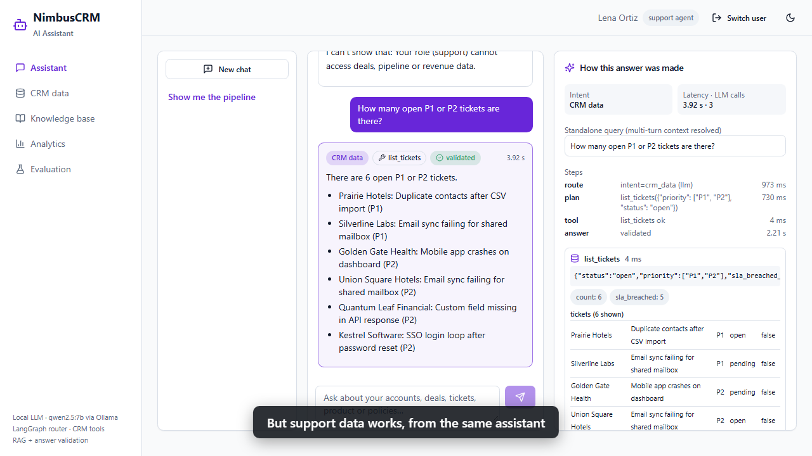
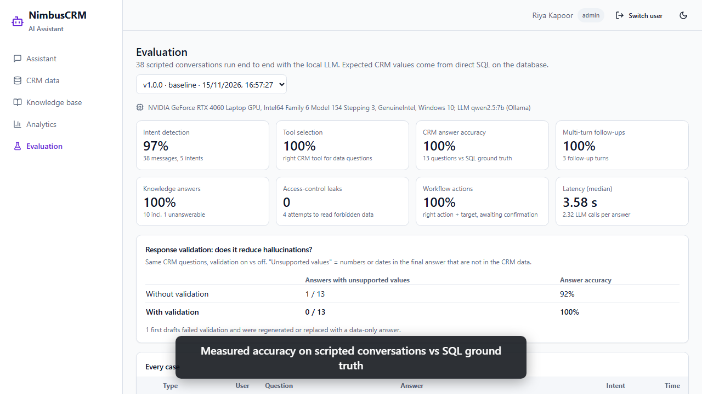

# CRM AI Assistant

**A GenAI enterprise assistant for a CRM.** Sales and support teams ask in plain English about their CRM data,
product features and business policies, and ask it to *do* things (create tasks, log notes, move deals, escalate
tickets). Intent detection routes every message to the right capability, follow-up questions keep their context,
every number in a data answer is validated against the CRM before it is shown, and every user only ever sees the
records their role allows. Runs fully on a local LLM.



▶ **Full demo video:** [`demo/demo.mp4`](demo/demo.mp4)

## The problem

CRM users spend their day clicking through list views and reports to answer simple questions ("what renews this
quarter?", "who approves this discount?", "what's open on this account?"). Generic chatbots can't reach live CRM data,
leak records across roles, and make up numbers, which is unacceptable for revenue data.

## What it does

| Capability | How |
|---|---|
| **Intent detection & query routing** | One JSON LLM call classifies each message as *CRM data*, *knowledge*, *workflow*, *chit-chat* or *out of scope*, with a keyword fallback; a LangGraph state machine routes it |
| **Context-aware multi-turn conversation** | The router rewrites follow-ups into a standalone query using history + per-conversation entity memory ("what about **their** tickets?" → "open tickets for Cedar Energy") |
| **Natural-language CRM data access** | The LLM plans tool calls (accounts, account 360, deals, pipeline, tickets, activities); arguments are validated with Pydantic; tools call the CRM backend API **as the signed-in user** |
| **RAG-based Q&A** | Product help center + internal sales playbook: hybrid BM25 + vector search, cross-encoder reranking, cited answers with page preview, explicit "not found" |
| **Predefined workflows** | Create task, log note, update deal stage, escalate ticket: the assistant prepares the change, the user confirms, the write is audit-logged |
| **Response validation** | Every number and date in a data answer must appear in the tool results; failing answers are regenerated once, then replaced by a deterministic data-only answer |
| **Prompt engineering** | Role-specific router, planner, answer and workflow prompts in JSON mode; strict rules (no invented filters, exact figures, no raw field names) |
| **Enterprise-grade access control** | Row + field level: reps see own accounts, managers their team, support sees tickets but no deals/revenue; knowledge workspaces per role; the LLM never touches the database |
| **Observability** | Live step stream over WebSocket, an "how this answer was made" inspector (intent, standalone query, tool calls, validation, sources), analytics, audit log |

## Architecture



Details and design decisions: [docs/architecture.md](docs/architecture.md).

## Results (measured)

Hardware: **NVIDIA RTX 4060 Laptop GPU (8 GB)**, Windows 11 · `qwen2.5:7b` via Ollama · 38 scripted conversation turns,
expected CRM values computed with direct SQL ([`backend/eval/run_eval.py`](backend/eval/run_eval.py)).

| What | Result |
|---|---|
| Intent detection | **97%** (37/38) |
| Tool selection for data questions | **100%** (13/13) |
| CRM answer accuracy vs SQL ground truth | **100%** (13/13) |
| Multi-turn follow-ups ("their", "they") | **100%** (3/3) |
| Knowledge answers (incl. 1 unanswerable, correctly refused) | **100%** (10/10) |
| Access-control leaks (support asking for pipeline, rep asking for another rep's account, ...) | **0** of 4 attempts |
| Workflow actions prepared correctly (not executed until confirmed) | **100%** (4/4) |
| Chit-chat / out-of-scope handling | **100%** (4/4) |
| Median latency | **3.6 s** · 2.3 LLM calls per answer |

**Response validation (same 13 data questions):** without validation, 1 answer contained an invented figure and
accuracy was 92%; with validation, 0 answers contained unsupported values and accuracy was 100%.

Every case with question, answer and score: **Evaluation** page in the app or
[`backend/eval/results/`](backend/eval/results). 

## Tech stack

Python 3.11 · FastAPI · WebSockets · LangGraph · Pydantic · SQLAlchemy/SQLite · Qdrant · rank-bm25 ·
sentence-transformers (cross-encoder) · PyMuPDF · Ollama (`qwen2.5:7b`, `nomic-embed-text`) · Next.js 15 · React 19 ·
Tailwind · Recharts · Playwright · pytest · Docker.

## Quick start

**Windows (one click):** install [Ollama](https://ollama.com), Python 3.11 and Node 22, then

```bat
pip install -r requirements.txt
run_demo.bat
```

It pulls the models, generates the demo CRM and knowledge documents, indexes them and opens http://localhost:3300.
Sign in as **Ananya (sales rep)**, **Vikram (sales manager)**, **Lena (support)** or **Riya (admin)** and compare what
each one can see.

**Linux / macOS:**

```bash
pip install -r requirements.txt
ollama pull qwen2.5:7b && ollama pull nomic-embed-text
python data/make_docs.py && python backend/scripts/seed.py
uvicorn app.main:app --app-dir backend --port 8300 &
cd frontend && npm install && npm run build && npm run start
```

**Docker:** `docker compose up --build` (API :8300, dashboard :3300, Ollama with GPU). Written and syntax-checked, but
not run on the development laptop, which has no Docker.

## Tests

```bash
python -m pytest                     # 62 tests (all passing): access control, tools, validation, router, full graph, workflows, API, WebSocket, RAG
python -m pytest tests/e2e           # Playwright end-to-end test against the running app (passing)
python backend/eval/run_eval.py --release v1.0.0 --label baseline   # end-to-end evaluation with the local LLM
```

Unit tests use a scripted fake LLM, so they run in seconds without a GPU.

## Data

Everything is **synthetic and fictional**: "NimbusCRM" is not a real product, and the 40 companies, contacts and
tickets are generated with a fixed seed ([`backend/app/crm/seed_data.py`](backend/app/crm/seed_data.py), invented
names, `example.com` emails, 555 phone numbers). The 12 help-center and playbook documents are generated by
[`data/make_docs.py`](data/make_docs.py). Connect a real CRM by replacing `backend/app/crm/service.py` with calls to its API
(Salesforce, HubSpot, Dynamics) behind the same access rules.

## Screenshots

| | |
|---|---|
|  |  |
|  |  |
|  |  |

## Limitations & roadmap

* A 7B local model occasionally misroutes or skips a field; the inspector shows exactly what happened, and a larger
  model behind the same interface improves accuracy.
* The validator checks numbers and dates, not names or free-text claims.
* Next: connectors for Salesforce / HubSpot APIs, SSO, streaming tokens, email drafting with approval, Slack/Teams bot.

---

Built by **Akash Kumar**: AI engineer for computer vision, GenAI, RAG and AI agents.
Need this for your business? **akashkr19857@gmail.com** · [LinkedIn](https://www.linkedin.com/in/akash-kumar-883220192)
· [GitHub](https://github.com/akashkr19857)
