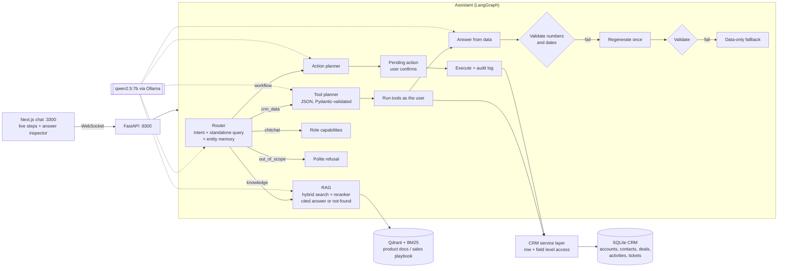

# Architecture

## Design decisions

| Decision | Why |
|---|---|
| Router produces intent **and** a standalone query in one JSON call | Multi-turn follow-ups ("what about their tickets?") are resolved once, up front, using history + entity memory; every later step works on a self-contained question. Keyword fallback if the JSON is unusable. |
| Entity memory per conversation | The account / deal / ticket in focus is stored after each turn (from the router and from single-row tool results), so pronouns resolve even after several turns. |
| LLM proposes tool calls, code validates them | Tool names and arguments are checked with Pydantic (`extra="forbid"`, enums for stages/priorities); invalid calls are rejected instead of executed. |
| One access-controlled service layer | The REST API, the CRM explorer page and the assistant's tools all call the same functions as the signed-in user: reps see their own records, managers their team, support has no deals/revenue. The LLM never touches the database directly. |
| Validate numbers and dates against tool results | The most damaging CRM hallucination is a wrong figure. Every number/date in a data answer must exist in the tool output (with tolerance for $1.2M-style rounding); otherwise the answer is regenerated once with the issues listed, and if it still fails a deterministic data-only answer is shown. |
| Writes need explicit confirmation | Workflow intents only produce a *pending action*; nothing changes until the user clicks Confirm, and every write is audit-logged. |
| Knowledge RBAC by workspace | Product docs are visible to everyone; the internal sales playbook (pricing, discounts) only to sales roles. Retrieval filters by the user's workspaces. |
| Local LLM | CRM data is confidential; nothing leaves the machine, no per-token cost. |

## Roles (demo)

| User | Role | CRM data | Knowledge |
|---|---|---|---|
| Ananya Rao | Sales rep, West | own 10 accounts, own deals | docs + sales playbook |
| Vikram Mehta | Sales manager, West | team's 20 accounts | docs + sales playbook |
| Lena Ortiz | Support agent | all accounts (no ARR), all tickets; no deals/pipeline | docs only |
| Riya Kapoor | RevOps admin | everything | everything |
